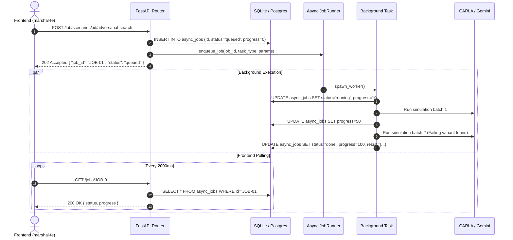
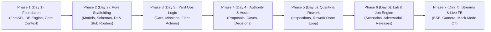

# Marshal Control Tower — Backend Scaffolding & API Implementation Plan

> **Target Package**: `src/marshal_api/` inside `marshal-ai`  
> **Tech Stack**: **FastAPI**, **SQLModel** (SQLAlchemy 2.0 + Pydantic v2), **Alembic**, **ULID**, **Asyncio**  
> **Database**: Dual-Engine (**SQLite** `sqlite+aiosqlite:///./marshal.db` for local dev & testing ⇋ **PostgreSQL 16+** `postgresql+asyncpg://...` for staging/production)  
> **Frontend Contract**: Strict 1:1 parity with [`marshal-fe/src/lib/api.ts`](file:///home/farissbayu/projects/marshal/marshal-fe/src/lib/api.ts) and [`marshal-fe/src/lib/schemas.ts`](file:///home/farissbayu/projects/marshal/marshal-fe/src/lib/schemas.ts)

---

## 1. System Map & Clean Architecture Layout

The backend is structured under `src/marshal_api/` following **Clean Domain-Driven Architecture**. It decouples HTTP transport, business orchestration, simulation bridges, and persistence.

```
marshal-ai/
├── src/
│   ├── marshal_ai/                # Existing AI agents, simulation runners & CARLA backends
│   │   ├── flows/
│   │   ├── lab/
│   │   ├── driving/
│   │   └── ...
│   └── marshal_api/               # NEW: Production FastAPI Control Tower Service
│       ├── __init__.py
│       ├── main.py                # FastAPI factory, CORS, exception handlers & lifespan
│       ├── config.py              # Pydantic BaseSettings (DB URL, CORS, Pub/Sub, timeouts)
│       ├── core/
│       │   ├── auth.py            # RBAC dependencies (Supervisor, Inspector, Worker, Engineer)
│       │   ├── context.py         # Tenant & Actor ContextVars for multi-tenancy
│       │   ├── errors.py          # ApiError normalization matching FE error schema
│       │   └── idempotency.py     # IdempotencyKey header interceptor
│       ├── db/
│       │   ├── session.py         # Dual-engine session factory (SQLite PRAGMA + Postgres pooling)
│       │   ├── tenant.py          # Level 1 ORM tenant isolation query interceptor
│       │   └── base.py            # Base repository utilities & paginators
│       ├── models/                # SQLModel table definitions (ULID keys)
│       │   ├── base.py            # TenantScopedModel, ULID generator, timestamps
│       │   ├── yard.py            # Tenant, Plant, User, Car, BuildSheet, Truck, Zone, Bay
│       │   ├── assistance.py      # AssistanceCase, AssistanceOption, Proposal
│       │   ├── quality.py         # InspectionResult, VisualFinding, StepCheck, Report, ReworkTicket
│       │   └── lab.py             # TestRequest, Scenario, TestRun, Release, Job, MediaArtifact
│       ├── schemas/               # Request/Response DTOs (1:1 with marshal-fe schemas.ts)
│       │   ├── common.py          # Pagination envelope, Health, Actor, ErrorResponse
│       │   ├── yard.py            # CarSummary, CarDetail, YardOverview, MapPoint
│       │   ├── assistance.py      # AssistanceCaseResponse, DecideAssistanceRequest
│       │   ├── proposals.py       # ProposalResponse, DecideProposalRequest
│       │   ├── quality.py         # InspectionResultResponse, VisualReport, FunctionalReport
│       │   ├── lab.py             # ScenarioDetail, CreateScenarioRequest, ReviewScenarioRequest
│       │   └── jobs.py            # JobStatusResponse, MediaResponse
│       ├── services/              # Domain services (Business rules & side-effects)
│       │   ├── yard_service.py    # Car missions, holds, truck ETAs, zone closures
│       │   ├── assist_service.py  # Option decision dispatching, 60s escalation monitor
│       │   ├── proposal_service.py# Human authority execution (re-plan, rework approval)
│       │   ├── quality_service.py # Report consolidation, rework completion -> re-inspection
│       │   ├── lab_service.py     # Spec generation, adversarial triggers, release gate
│       │   └── media_service.py   # Cloud Storage signed URL resolver & proxy
│       ├── workers/               # Async Job Execution Engine
│       │   ├── job_runner.py      # In-process background queue (for AI & CARLA runs)
│       │   └── tasks.py           # Scenario generation, adversarial search & eval workers
│       ├── streaming/             # Real-time Web Streams
│       │   ├── sse.py             # Server-Sent Events broadcaster (/events)
│       │   └── camera_proxy.py    # Multipart MJPEG stream proxy (/camera.mjpg)
│       └── api/
│           ├── v1/
│           │   ├── router.py      # Central v1 router aggregation
│           │   ├── health.py      # /healthz, /readyz, /me, /dev/actor
│           │   ├── overview.py    # /overview, /kpis
│           │   ├── yard.py        # /yard, /cars, /map, /trucks, /zones
│           │   ├── proposals.py   # /proposals, /proposals/{id}/decide
│           │   ├── assistance.py  # /assistance/cases, /assistance/kpis
│           │   ├── quality.py     # /inspection/results, /reports, /rework/bays
│           │   ├── lab.py         # /lab/test-requests, /lab/scenarios, /lab/releases
│           │   ├── jobs.py        # /jobs/{id}
│           │   └── media.py       # /media/{id}
│           └── stream.py          # /events (SSE), /camera.mjpg
```

---

## 2. Complete Frontend Endpoint Inventory & Scaffolding Contract

Every endpoint expected by `marshal-fe` is mapped below, including **Role Guards**, **Input/Output Schemas**, and **Side Effects / Action Handlers**.

### 2.1 System, Identity & Overview

| Method | Endpoint | Role Guard | Request Body / Query | Response DTO | Side Effects & Action Handlers |
| :--- | :--- | :--- | :--- | :--- | :--- |
| `GET` | `/healthz` | Public | None | `Health` | Checks DB connectivity and uptime. |
| `GET` | `/readyz` | Public | None | `Readiness` | Probes DB, Pub/Sub event bus, and CARLA RPC port. |
| `GET` | `/me` | Any Auth | None | `Actor` | Returns current actor profile and permissions. |
| `POST`| `/dev/actor` | Dev/Admin | `{ role: Role }` | `Actor` | Switches mock actor session context (dev/demo convenience). |
| `GET` | `/overview` | Any Auth | None | `Overview` | Aggregates car state counts, open assistance, pending proposals, and urgent alerts. |
| `GET` | `/kpis` | Any Auth | None | `KpiResponse` | Computes factory KPIs (FPY, cycle times, throughput) from database. |

---

### 2.2 Yard Operations & Vehicle Fleet (Flow 1)

| Method | Endpoint | Role Guard | Request Body / Query | Response DTO | Side Effects & Action Handlers |
| :--- | :--- | :--- | :--- | :--- | :--- |
| `GET` | `/yard` | Any Auth | None | `Yard` | Returns complete plant snapshot: summary, cars, trucks, zones, and rework bays. |
| `GET` | `/cars` | Any Auth | `q`, `state`, `location`, `truck`, `flags`, `page`, `limit` | `Page[CarSummary]` | Paginated car inventory query with multi-column filtering. |
| `GET` | `/cars/{vin}` | Any Auth | None | `CarDetail` | Retrieves deep car record including its `BuildSheet`. |
| `GET` | `/map` | Any Auth | None | `YardMap` | Returns static coordinates from `plant_map.yaml`. |
| `POST`| `/trucks/{truckId}/eta` | `supervisor` | `{ eta: ISOString, reason?: string }` | `Record[str, Any]` | Updates truck arrival. If delayed, emits late-truck exception triggering Gemini re-plan. |
| `POST`| `/trucks/{truckId}/load`| `supervisor` | `{}` | `Record[str, Any]` | Verifies all assigned cars are in `yard` state; updates car states to `shipped`. |
| `POST`| `/zones/{zone}/closure` | `supervisor` | `{ closed: boolean, reason?: string }` | `Record[str, Any]` | Toggles physical zone open/closed. Halts or reroutes approaching vehicles. |
| `POST`| `/cars/{vin}/missions`  | `supervisor` | `{ destination: string, reason?: string }` | `Record[str, Any]` | **Action**: Validates car is not held; dispatches mission via `MissionClient`; updates state to `driving`. |
| `POST`| `/cars/{vin}/hold`      | `supervisor` | `{ reason: string, duration_minutes?: int }`| `Record[str, Any]` | **Action**: Emits `mission.hold` to CARLA; marks car state as `held`; sets `"held"` flag. |
| `POST`| `/cars/{vin}/resume`    | `supervisor` | `{}` | `Record[str, Any]` | **Action**: Emits `mission.resume`; transitions state to `waiting_dispatch`; clears flag. |

---

### 2.3 Proposals & Human Authority Decisions

| Method | Endpoint | Role Guard | Request Body / Query | Response DTO | Side Effects & Action Handlers |
| :--- | :--- | :--- | :--- | :--- | :--- |
| `GET` | `/proposals` | Any Auth | `kind`, `status`, `page`, `limit` | `Page[Proposal]` | Returns supervisor proposal inbox sorted newest first. |
| `POST`| `/proposals/{id}/decide`| `supervisor` | `{ decision: string, actor_id: string, note?: string }` | `Record[str, Any]` | **Action (Human Authority Gate)**:<br/>1. Verifies decision is allowed in `proposal.allowed_actions`.<br/>2. Sets status to `approved`/`rejected`.<br/>3. **Executes Payload Action**:<br/>- If *replan*: sends new slot missions to cars.<br/>- If *rework*: books car into rework bay.<br/>- If *review*: clears visual flag and sends car to test track. |

---

### 2.4 Remote Assistance Desk (Flow 2)

| Method | Endpoint | Role Guard | Request Body / Query | Response DTO | Side Effects & Action Handlers |
| :--- | :--- | :--- | :--- | :--- | :--- |
| `GET` | `/assistance/cases` | Any Auth | `status`, `page`, `limit` | `Page[AssistanceCase]` | Returns remote assistance queue (`OPEN`, `ESCALATED`, `RESOLVED`). |
| `GET` | `/assistance/cases/{id}`| Any Auth | None | `AssistanceCase` | Returns incident card: one-line situation, ranked options, and video clip ID. |
| `GET` | `/assistance/kpis` | Any Auth | None | `AssistanceKpis` | Returns open/resolved counts and average resolution latency. |
| `POST`| `/assistance/cases/{id}/decide`| `supervisor` | `{ option: string, actor_id: string }` | `Record[str, Any]` | **Action**:<br/>1. Records supervisor's human choice.<br/>2. Dispatches `assist.choose` to CARLA BehaviorAgent.<br/>3. Marks case `RESOLVED`; transitions car out of stopped state. |

---

### 2.5 Quality Inspection & Rework (Flows 3, 4 & 5)

| Method | Endpoint | Role Guard | Request Body / Query | Response DTO | Side Effects & Action Handlers |
| :--- | :--- | :--- | :--- | :--- | :--- |
| `GET` | `/inspection/results` | Any Auth | `kind`, `verdict`, `page`, `limit` | `Page[InspectionResult]` | Paginated inspection list with defect counts. |
| `GET` | `/inspection/kpis` | Any Auth | None | `InspectionKpis` | First-pass yield, review share, and total failure metrics. |
| `GET` | `/cars/{vin}/inspection/visual` | Any Auth | None | `VisualInspection` | Returns 8-zone findings, defect observations, and build sheet mismatches. |
| `GET` | `/cars/{vin}/inspection/functional` | Any Auth | None | `FunctionalInspection` | Returns track steps (lights, brake tests) with telemetry vs camera agreement. |
| `GET` | `/reports` | Any Auth | `verdict`, `page`, `limit` | `Page[Report]` | Paginated car quality certificate reports. |
| `GET` | `/cars/{vin}/report` | Any Auth | None | `Report` | Single comprehensive vehicle passport: findings, rework tickets, and re-inspection status. |
| `GET` | `/rework/bays` | Any Auth | None | `{ items: ReworkBay[] }` | Operational capacity and active occupancy of rework bays. |
| `POST`| `/cars/{vin}/rework/done` | `worker` | `{ actor_id: string }` | `Record[str, Any]` | **Action**:<br/>1. Marks rework ticket as `DONE`.<br/>2. Sets car report `reinspection_status = "WAITING"`.<br/>3. Dispatches mission sending car back to gate for **failed-items-only re-inspection**. |

---

### 2.6 Test Lab & Release Gate (Flows 6 & 7)

| Method | Endpoint | Role Guard | Request Body / Query | Response DTO | Side Effects & Action Handlers |
| :--- | :--- | :--- | :--- | :--- | :--- |
| `GET` | `/lab/test-requests` | Any Auth | `status`, `page`, `limit` | `Page[TestRequest]` | Lists operational incidents converted to test requests. |
| `GET` | `/lab/scenarios` | Any Auth | `status`, `tag`, `page`, `limit` | `Page[Scenario]` | Paginated CARLA test scenarios. |
| `GET` | `/lab/scenarios/{id}` | Any Auth | None | `ScenarioDetail` | Full spec JSON, validator notes, dry run results, and adversarial reports. |
| `POST`| `/lab/scenarios` | `engineer` | `{ situation: string, source: string, request_id?: string }` | `{ job_id: string, status: "queued" }` | **Async Action**:<br/>1. Creates `test_request` record.<br/>2. Enqueues background worker to prompt Gemini -> generate `ScenarioSpec` -> validate -> compile.<br/>3. Returns immediately with `job_id`. |
| `POST`| `/lab/scenarios/{id}/review` | `engineer` | `{ decision: "approved" \| "rejected", actor_id: string, note?: string }` | `Record[str, Any]` | **Action**: Engineer gates scenario into test library (`runnable`) or marks `rejected`. |
| `POST`| `/lab/scenarios/{id}/adversarial-search` | `engineer` | `{}` | `{ job_id: string, status: "queued" }` | **Async Action**:<br/>1. Enqueues background worker to mutate weather, light, and occluders on CARLA.<br/>2. Returns `job_id` for frontend progress tracking. |
| `GET` | `/lab/releases` | Any Auth | `page`, `limit` | `Page[Release]` | Lists driving software release candidates (`behavior-agent-1.0`, etc.). |
| `GET` | `/lab/releases/{id}` | Any Auth | None | `Release` | Detailed release card with regression test passes and failures. |
| `POST`| `/lab/releases/{id}/evaluate` | `engineer` | `{}` | `{ job_id: string, status: "queued" }` | **Async Action**: Spawns regression suite execution on CARLA. Returns `job_id`. |
| `POST`| `/lab/releases/{id}/approve` | `engineer` | `{ actor_id: string }` | `Record[str, Any]` | **Action**: Approves software release gate if all regression criteria pass. |

---

### 2.7 Async Jobs, Media & Streaming

| Method | Endpoint | Format | Query / Params | Response | Functionality |
| :--- | :--- | :--- | :--- | :--- | :--- |
| `GET` | `/jobs/{jobId}` | JSON | None | `Job` | Returns execution status (`queued`, `running`, `done`, `failed`), progress `0..100%`, and result payload. |
| `GET` | `/media/{mediaId}`| JSON | None | `Media` | Resolves GCS URI or local storage path to a secure, signed HTTP URL with 1-hour expiration. |
| `GET` | `/events` | SSE | `since?: int` | `text/event-stream` | Real-time Server-Sent Events stream emitting `FlowEvent` objects. Supports reconnects via sequence cursor. |
| `GET` | `/camera.mjpg` | MJPEG | None | `multipart/x-mixed-replace` | Live camera stream proxying the CARLA viewer / plant overview camera. |

---

## 3. Asynchronous Job & Worker Subsystem

Long-running operations (such as generating CARLA scenarios, executing 10–60 simulation variants during adversarial search, and running regression suites) cannot block the HTTP worker thread.



### In-Process Async Job Runner Implementation

```python
# src/marshal_api/workers/job_runner.py
import asyncio
import logging
from typing import Callable, Awaitable, Dict, Any
from sqlmodel.ext.asyncio.session import AsyncSession
from marshal_api.models.lab import AsyncJob, JobStatus
from marshal_api.db.session import engine

log = logging.getLogger("marshal.job_runner")


class JobRunner:
    def __init__(self):
        self._tasks: Dict[str, asyncio.Task] = {}

    def enqueue(self, job_id: str, handler: Callable[[str, Dict[str, Any]], Awaitable[None]], payload: Dict[str, Any]):
        task = asyncio.create_task(self._run_wrapper(job_id, handler, payload))
        self._tasks[job_id] = task

    async def _run_wrapper(self, job_id: str, handler: Callable, payload: Dict[str, Any]):
        async with AsyncSession(engine) as session:
            job = await session.get(AsyncJob, job_id)
            if not job:
                return
            job.status = JobStatus.RUNNING
            job.progress = 5
            await session.commit()

        try:
            await handler(job_id, payload)
        except Exception as exc:
            log.exception(f"Job {job_id} failed: {exc}")
            async with AsyncSession(engine) as session:
                job = await session.get(AsyncJob, job_id)
                if job:
                    job.status = JobStatus.FAILED
                    job.error = str(exc)
                    await session.commit()
```

---

## 4. Realtime Streaming Subsystem

### 4.1 Server-Sent Events (`/events`)
The frontend subscribes to `/events` using an `EventSource`. The backend hooks into the internal `marshal_ai` event bus or SQLite event table:

```python
# src/marshal_api/streaming/sse.py
import asyncio
from fastapi import APIRouter, Request
from sse_starlette.sse import EventSourceResponse
from marshal_api.models.lab import EventLog

router = APIRouter()


async def event_generator(request: Request, since: int = 0):
    last_seq = since
    while True:
        if await request.is_disconnected():
            break

        # Query events with seq > last_seq
        events = await fetch_events_since(last_seq)
        for ev in events:
            yield {
                "event": "message",
                "id": str(ev.seq),
                "data": ev.model_dump_json()
            }
            last_seq = ev.seq

        await asyncio.sleep(1.0)


@router.get("/events")
async def stream_events(request: Request, since: int = 0):
    return EventSourceResponse(event_generator(request, since))
```

### 4.2 Camera Stream Proxy (`/camera.mjpg`)
Proxies the multipart stream from CARLA's headless renderer or returns simulated feed when CARLA is idle:

```python
# src/marshal_api/streaming/camera_proxy.py
import httpx
from fastapi import APIRouter
from fastapi.responses import StreamingResponse

router = APIRouter()


@router.get("/camera.mjpg")
async def stream_camera():
    async def proxy_mjpeg():
        async with httpx.AsyncClient() as client:
            try:
                async with client.stream("GET", "http://localhost:8080/camera.mjpg", timeout=None) as response:
                    async for chunk in response.aiter_bytes():
                        yield chunk
            except httpx.ConnectError:
                # Return standby placeholder frame stream
                yield generate_standby_frame()

    return StreamingResponse(
        proxy_mjpeg(),
        media_type="multipart/x-mixed-replace; boundary=frame"
    )
```

---

## 5. Security, Multi-Tenancy & Authorization

### 5.1 RBAC Role Dependency
`marshal-fe` operates under four discrete roles: `supervisor`, `inspector`, `worker`, `engineer`. Critical mutative actions are guarded:

```python
# src/marshal_api/core/auth.py
from fastapi import Depends, HTTPException, Header, status
from typing import List
from marshal_api.models.yard import Role


class RequireRole:
    def __init__(self, allowed_roles: List[str]):
        self.allowed_roles = allowed_roles

    def __call__(self, x_role: str = Header("supervisor", alias="X-Actor-Role")):
        if x_role not in self.allowed_roles:
            raise HTTPException(
                status_code=status.HTTP_403_FORBIDDEN,
                detail=f"Role '{x_role}' unauthorized for this action. Required: {self.allowed_roles}"
            )
        return x_role
```

---

## 6. Implementation & Scaffolding Roadmap

The implementation is structured into **7 disciplined phases**, ensuring that **Day 2 is exclusively dedicated to structural scaffolding, endpoint signatures, data models, schemas, and dependency injection plumbing (zero business logic)**. Business logic implementations strictly begin on **Day 3**.



---

### Phase 1: Core Foundation & Dual-Engine Infrastructure (Day 1)
*Goal: Establish runtime environment, dual-engine database session, and multi-tenant context.*
1. **Repository & Dependencies**:
   - Initialize `src/marshal_api/` structure.
   - Configure `pyproject.toml` dependencies: `fastapi`, `sqlmodel`, `aiosqlite`, `asyncpg`, `sse-starlette`, `ulid-py`.
2. **Configuration & App Factory**:
   - Create `config.py` with `Settings` (defaulting `MARSHAL_DB_URL=sqlite+aiosqlite:///./marshal.db`).
   - Create `main.py` configuring CORS middleware (`http://localhost:5173` and preview origins), error handlers, and OpenAPI metadata.
3. **Dual-Engine Session Provider (`db/session.py`)**:
   - Setup async engine with SQLite `PRAGMA foreign_keys = ON;` and `journal_mode = WAL;`.
   - Setup Alembic with `render_as_batch=True`.
4. **Core Security & Context**:
   - Create `models/base.py` (`TenantScopedModel`, `generate_ulid()`, UTC timestamps).
   - Create `core/context.py` (ContextVars for `tenant_id` and `actor_id`).
   - Create `core/errors.py` (Normalized `ApiError` handler matching `marshal-fe`).

---

### Phase 2: Pure Scaffolding, Models, Schemas & DI Plumbing — Zero Business Logic (Day 2)
*Goal: Complete 100% of the project's structural scaffolding, SQLModel table schemas, Pydantic DTOs, dependency injection providers, and stub endpoint routes. **No business logic or simulation integrations are touched in this phase.***

1. **Complete SQLModel Table Definitions (`models/`)**:
   - `models/yard.py`: `Tenant`, `Plant`, `User`, `Car`, `BuildSheet`, `Truck`, `Zone`, `ReworkBay`, `PlantMapPoint`.
   - `models/assistance.py`: `AssistanceCase`, `AssistanceOption`, `Proposal`.
   - `models/quality.py`: `InspectionResult`, `VisualFinding`, `BuildSheetMismatch`, `FunctionalStepCheck`, `CarReport`, `ReworkTicket`.
   - `models/lab.py`: `TestRequest`, `Scenario`, `TestRun`, `Release`, `ReleaseEvalTest`, `AsyncJob`, `MediaArtifact`, `EventLog`.
2. **Complete Request/Response DTO Schemas (`schemas/`)**:
   - Define all Pydantic v2 schemas matching 100% of `marshal-fe/src/lib/schemas.ts` and `api.ts`:
     - `schemas/common.py`: Generic `Page[T]` envelope (`page`, `limit`, `total`, `last_page`), `Health`, `Readiness`, `Actor`.
     - `schemas/yard.py`: `CarSummary`, `CarDetail`, `Yard`, `YardMap`, `Truck`, `Zone`, `ReworkBay`.
     - `schemas/proposals.py`: `Proposal`, `DecideProposalRequest`.
     - `schemas/assistance.py`: `AssistanceCase`, `AssistanceKpis`, `DecideAssistanceRequest`.
     - `schemas/quality.py`: `InspectionResult`, `InspectionKpis`, `VisualInspection`, `FunctionalInspection`, `Report`.
     - `schemas/lab.py`: `TestRequest`, `Scenario`, `ScenarioDetail`, `Release`, `CreateScenarioRequest`, `ReviewScenarioRequest`.
     - `schemas/jobs.py`: `Job`, `Media`.
3. **Complete Dependency Injection (DI) Infrastructure (`core/deps.py`)**:
   - `get_session()`: Async database session dependency.
   - `get_current_tenant()`, `get_current_actor()`: Extracts tenant/actor from `X-Tenant-ID` and `X-Actor-ID` headers.
   - `RequireRole(["supervisor", ...])`: Reusable RBAC role guard.
   - `get_idempotency_key()`: Extracts and registers `Idempotency-Key` headers.
   - Stub Service Dependencies: `get_yard_service()`, `get_assistance_service()`, `get_lab_service()`, `get_job_runner()`.
4. **Complete Router Scaffolding with Stub Endpoints (`api/v1/`)**:
   - Scaffold **every single endpoint** from the inventory with typed route signatures, tags, status codes, and response models.
   - Router handlers return typed stub responses (e.g. empty paginated envelopes `{ items: [], pagination: {...} }` or placeholder objects):
     - `api/v1/health.py`: `/healthz`, `/readyz`, `/me`, `POST /dev/actor`.
     - `api/v1/overview.py`: `/overview`, `/kpis`.
     - `api/v1/yard.py`: `/yard`, `/cars`, `/cars/{vin}`, `/map`, `POST /trucks/{id}/eta`, `POST /trucks/{id}/load`, `POST /zones/{zone}/closure`, `POST /cars/{vin}/missions`, `POST /cars/{vin}/hold`, `POST /cars/{vin}/resume`.
     - `api/v1/proposals.py`: `/proposals`, `POST /proposals/{id}/decide`.
     - `api/v1/assistance.py`: `/assistance/cases`, `/assistance/cases/{id}`, `/assistance/kpis`, `POST /assistance/cases/{id}/decide`.
     - `api/v1/quality.py`: `/inspection/results`, `/inspection/kpis`, `/cars/{vin}/inspection/visual`, `/cars/{vin}/inspection/functional`, `/reports`, `/cars/{vin}/report`, `/rework/bays`, `POST /cars/{vin}/rework/done`.
     - `api/v1/lab.py`: `/lab/test-requests`, `/lab/scenarios`, `/lab/scenarios/{id}`, `POST /lab/scenarios`, `POST /lab/scenarios/{id}/review`, `POST /lab/scenarios/{id}/adversarial-search`, `/lab/releases`, `/lab/releases/{id}`, `POST /lab/releases/{id}/evaluate`, `POST /lab/releases/{id}/approve`.
     - `api/v1/jobs.py`: `/jobs/{id}`.
     - `api/v1/media.py`: `/media/{id}`.
5. **Phase 2 Verification Gate**:
   - Run `pytest tests/test_scaffolding.py`:
     - Every endpoint is reachable and returns HTTP 200/202 without 500 errors.
     - Swagger UI at `http://localhost:8000/docs` validates 100% of input/output schemas against frontend contracts.

---

### Phase 3: Yard Operations & Vehicle Fleet Business Logic (Day 3)
*Goal: Implement real business logic, DB queries, and CARLA mission commands for Flow 1.*
1. **`services/yard_service.py` Implementation**:
   - Query layer: multi-tenant car search with filtering (`q`, `state`, `location`, `truck`, `flags`) and sorting.
   - Single car retrieval joining `BuildSheet`.
   - Yard snapshot aggregator: computes active cars, trucks, zones, and rework bays.
2. **Mutative Yard Actions & Simulator Bridge**:
   - `POST /cars/{vin}/missions`: validates vehicle state is not `held`; dispatches mission through `MissionClient`; updates car state to `driving`.
   - `POST /cars/{vin}/hold` & `POST /cars/{vin}/resume`: updates database flags and emits `mission.hold` / `mission.resume` to CARLA.
   - `POST /trucks/{id}/eta`: updates arrival timestamps; calculates delay; triggers late-truck exception event if delayed.
   - `POST /trucks/{id}/load`: verifies assigned cars are staged in yard slots; updates state to `shipped`.
   - `POST /zones/{zone}/closure`: updates zone state; reroutes or halts approaching cars.
3. **Verification**: Contract tests pass against `marshal-fe/src/lib/mock/fixtures/cars.ts` and `yard.ts`.

---

### Phase 4: Human Authority & Remote Assistance Business Logic (Day 4)
*Goal: Implement decision gates and remote assistance resolution for Flow 2.*
1. **`services/proposal_service.py` Implementation**:
   - Fetches supervisor proposals sorted chronologically.
   - `POST /proposals/{id}/decide`:
     - Validates actor has `supervisor` role.
     - Validates decision against `allowed_actions`.
     - **Action Execution**: If *replan*, dispatches new slot missions; if *rework*, books car into rework bay; if *review*, clears visual flag and moves car forward.
2. **`services/assist_service.py` Implementation**:
   - Fetches active assistance cases and calculates resolution latency KPIs.
   - `POST /assistance/cases/{id}/decide`:
     - Validates supervisor choice against offered options.
     - Emits `assist.choose` to BehaviorAgent via event bus / PubSub.
     - Marks case as `RESOLVED` and resumes car movement.
3. **Verification**: Contract tests pass against `fixtures/proposals.ts` and `fixtures/assistance.ts`.

---

### Phase 5: Quality Inspection, Reports & Rework Loop Business Logic (Day 5)
*Goal: Implement quality data consolidation and the worker rework return loop for Flows 3, 4, 5.*
1. **`services/quality_service.py` Implementation**:
   - Visual inspection query: aggregates 8 body zones, findings, defect observations, and build sheet variant check.
   - Functional inspection query: aggregates checklist items, telemetry ok, camera ok, and disagreement flags.
   - Car report query: merges visual + functional results into a unified vehicle quality passport.
   - Rework bays query: live capacity and occupancy tracking.
2. **Rework Completion & Re-Inspection Trigger**:
   - `POST /cars/{vin}/rework/done`:
     - Validates actor has `worker` role.
     - Marks rework ticket `status = "DONE"`.
     - Updates car report `reinspection_status = "WAITING"`.
     - Dispatches mission routing car back to gate for **failed-items-only re-inspection**.
3. **Verification**: Contract tests pass against `fixtures/inspection.ts` and `fixtures/reports.ts`.

---

### Phase 6: Test Lab, Asynchronous Job Engine & Releases Business Logic (Day 6)
*Goal: Implement async background tasks for scenario generation, adversarial search, and release evaluation (Flows 6 & 7).*
1. **Async Job Runner (`workers/job_runner.py`)**:
   - In-process async task queue tracking progress `0 -> 100%` in `async_jobs` table.
   - `GET /jobs/{id}` returns live status and execution output payload.
2. **Test Lab Services (`services/lab_service.py`)**:
   - `POST /lab/scenarios`: enqueues async worker calling Gemini `ScenarioGenerator` -> validates -> compiles spec. Returns `{ job_id, status: "queued" }`.
   - `POST /lab/scenarios/{id}/review`: engineer gates scenario into test library (`runnable`) or marks `rejected`.
   - `POST /lab/scenarios/{id}/adversarial-search`: enqueues async worker running CARLA parameter search (weather/occluders).
   - `POST /lab/releases/{id}/evaluate`: enqueues regression test suite execution.
   - `POST /lab/releases/{id}/approve`: engineer approves release gate.
3. **Media Service (`services/media_service.py`)**:
   - Resolves `media_id` to GCS signed URLs (1-hour expiration) or local file streaming URLs.
4. **Verification**: Contract tests pass against `fixtures/lab.ts`.

---

### Phase 7: Real-time Streams, CARLA Bridge & Mock Mode Off (Day 7)
*Goal: Connect live SSE events, camera streaming, and verify end-to-end frontend integration.*
1. **Real-time Web Streaming**:
   - `GET /events`: SSE `EventSource` stream subscribing to internal event bus / `EventLog`. Supports reconnects with sequence cursor (`?since=seq`).
   - `GET /camera.mjpg`: MJPEG proxy streaming CARLA's live camera feed.
2. **Frontend Mock Mode Off**:
   - Update `marshal-fe/.env.development`:
     ```env
     VITE_MOCK_MODE=false
     VITE_API_BASE_URL=http://localhost:8000/api/v1
     ```
3. **End-to-End Verification**:
   - Run CARLA simulation demo (`run_carla_scene1.sh`).
   - Verify supervisor dashboard reflects real-time car movements, gate inspections, assistance cards, and lab runs.

