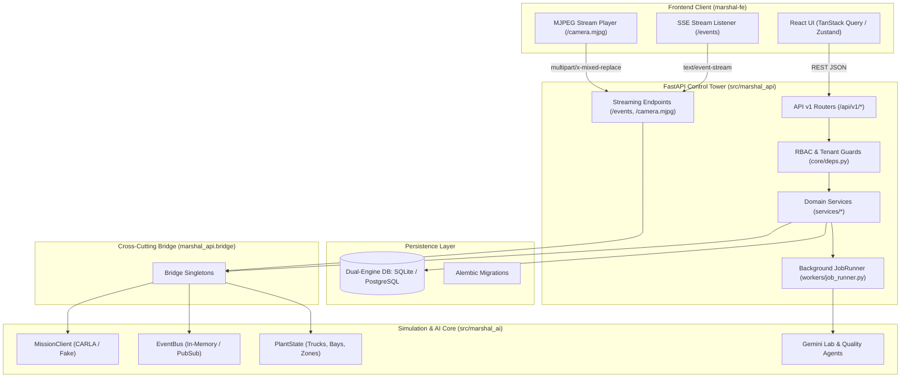

# Marshal Backend — Service Implementation Roadmap & Sprint Documentation

> **Target Package**: `src/marshal_api/` inside `marshal-ai`  
> **Status**: Phase 2 (Scaffolding) ✅ Complete → Phase 3+ (Business Logic & Service Implementation) 🚀 In Progress  
> **Tech Stack**: FastAPI, SQLModel (SQLAlchemy 2.0 + Pydantic v2), Alembic, ULID, Asyncio, Dual-Engine (SQLite ⇋ PostgreSQL)  
> **Frontend Contract**: Strict 1:1 parity with `marshal-fe/src/lib/api.ts` and `marshal-fe/src/lib/schemas.ts`

---

## 1. Executive Summary

The Marshal Control Tower backend has achieved **100% structural scaffolding** across all architectural layers:
- All **26 SQLModel relational tables** are defined with ULID primary keys, composite indices, and dual-engine JSON support.
- All **request/response Pydantic DTO schemas** strictly match the `marshal-fe` contract.
- All **37 HTTP endpoints** are routed under `/api/v1`, guarded with RBAC dependencies and idempotency interceptors.
- Initial Alembic migrations are written and tested.

However, all backend domain services (`YardService`, `AssistanceService`, `ProposalService`, `QualityService`, `LabService`, `MediaService`) are currently empty shells, and router endpoints return placeholder data from `_stubs.py`.

This documentation series outlines the complete, sprint-by-sprint implementation blueprint to systematically replace all stub handlers with production-grade business logic, relational database persistence, and simulation bridge integration.

---

## 2. Sprint Index & Implementation Master Plan

The implementation is broken into **6 targeted sprints**:

| Sprint Document | Focus Area | Primary Service / Component | Endpoints Covered |
|:---|:---|:---|:---|
| [**Sprint 0: Runtime Bridge Foundation**](file:///home/farissbayu/projects/marshal/marshal-ai/docs/sprint-00-bridge-foundation.md) | Cross-Cutting Bridge Layer | `marshal_api.bridge` | `MissionClient`, `EventBus`, `PlantState` |
| [**Sprint 1: Yard Operations & Fleet**](file:///home/farissbayu/projects/marshal/marshal-ai/docs/sprint-01-yard-service.md) | Flow 1: Yard Logistics & Autonomous Missions | `YardService` | 10 endpoints (`/yard`, `/cars`, `/map`, actions) |
| [**Sprint 2: Proposals & Assistance**](file:///home/farissbayu/projects/marshal/marshal-ai/docs/sprint-02-proposals-assistance.md) | Flow 2: Human Authority & Remote Safety Desk | `ProposalService`, `AssistanceService` | 6 endpoints (`/proposals`, `/assistance/*`) |
| [**Sprint 3: Quality & Rework Loop**](file:///home/farissbayu/projects/marshal/marshal-ai/docs/sprint-03-quality-rework.md) | Flows 3, 4, 5: Visual, Functional & Rework | `QualityService` | 8 endpoints (`/inspection/*`, `/reports`, `/rework/*`) |
| [**Sprint 4: Test Lab, Async Jobs & Media**](file:///home/farissbayu/projects/marshal/marshal-ai/docs/sprint-04-lab-jobs-media.md) | Flows 6, 7: Scenario Generation & Releases | `LabService`, `JobRunner`, `MediaService` | 12 endpoints (`/lab/*`, `/jobs/*`, `/media/*`) |
| [**Sprint 5: Realtime Streams & Overview**](file:///home/farissbayu/projects/marshal/marshal-ai/docs/sprint-05-streaming-overview.md) | Live Telemetry & Control Tower Dashboard | `SSE`, `CameraProxy`, Overview & Health | 8 endpoints (`/events`, `/camera.mjpg`, `/overview`, `/kpis`, `/healthz`, `/readyz`, `/me`, `/dev/actor`) |

---

## 3. High-Level Architecture & Component Interaction

---

## 4. Definition of Done (DoD) per Sprint

For each sprint to be considered complete, it must satisfy:
1. **Zero Stub Dependencies**: Target endpoints no longer import or invoke functions from `_stubs.py`.
2. **Strict Schema Parity**: All responses match the exact Pydantic DTO models validated by `marshal-fe/src/lib/schemas.ts`.
3. **Multi-Tenant Isolation**: Queries and mutations respect `X-Tenant-ID` and active plant context.
4. **Role Authorization**: Endpoints mutating operational states enforce appropriate RBAC role checks (`supervisor`, `worker`, `inspector`, `engineer`).
5. **Contract Test Coverage**: Pytest suite passes for all target endpoints, verifying both success and failure cases (404, 400, 403).
6. **Graceful Degraded Mode**: When the CARLA simulation is inactive, operations fall back cleanly without 500 server crashes.

