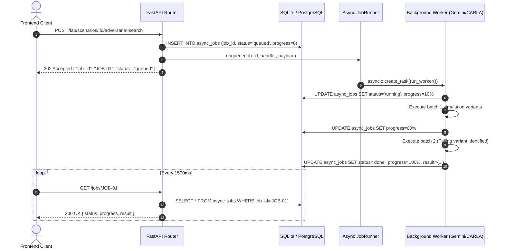

# Sprint 4 — Test Lab, Async Job Engine & Media Services (`LabService`, `JobRunner`, `MediaService`)

> **Target Flows**: Flows 6 & 7 (Scenario Generation, Adversarial Robustness Testing & Software Release Gates)  
> **Target Files**:
> - `src/marshal_api/services/lab_service.py` (Full implementation)
> - `src/marshal_api/workers/job_runner.py` (Async background execution & progress engine)
> - `src/marshal_api/services/media_service.py` (Full implementation)
> - `src/marshal_api/api/v1/lab.py` (Router rewiring, removing `_stubs.py`)
> - `src/marshal_api/api/v1/jobs.py` (Router rewiring)
> - `src/marshal_api/api/v1/media.py` (Router rewiring)
> - `tests/test_lab_service.py` & `tests/test_job_runner.py` (Test suites)

---

## 1. Overview & Scope

Sprint 4 delivers the autonomous testing and governance pipeline:
1. **Flow 6 (Test Lab & Adversarial Testing)**: Real factory incidents (remote assistance stops, late trucks) are converted into `TestRequest` items. Engineers prompt Gemini to generate formal CARLA scenario specs, review them into the test library, and launch adversarial parameter sweeps (weather, lighting, sensor occluders).
2. **Flow 7 (Software Release Gate)**: Driving software release candidates (`behavior-agent-1.0`) are evaluated against regression test suites. If all safety metrics pass, engineers approve the candidate for deployment.
3. **Async Job Runner**: Long-running AI generation and CARLA simulation batches (10s to minutes) cannot block HTTP request threads. The `JobRunner` provisions background `asyncio` tasks, records progress (0..100%) in the `async_jobs` table, and enables frontend polling via `GET /jobs/{id}`.
4. **Media Resolver**: Securely serves test run video clips, gate camera snapshots, and incident recordings via signed Cloud Storage URLs or local streaming proxies.

---

## 2. Endpoints Covered (12 Endpoints)

| Method | Path | Role Guard | Summary & Side Effects |
|:---|:---|:---|:---|
| `GET` | `/lab/test-requests` | Any Auth | Lists operational incidents converted to scenario requests. |
| `GET` | `/lab/scenarios` | Any Auth | Paginated catalog of CARLA test scenarios with tag filtering. |
| `GET` | `/lab/scenarios/{id}` | Any Auth | Complete spec JSON, validator notes, dry run results, and run history. |
| `POST`| `/lab/scenarios` | `engineer` | **Async**: Spawns Gemini scenario generation worker; returns `{job_id, status: "queued"}`. |
| `POST`| `/lab/scenarios/{id}/review` | `engineer` | Engineer approves scenario into library (`runnable`) or marks `rejected`. |
| `POST`| `/lab/scenarios/{id}/adversarial-search`| `engineer`| **Async**: Spawns CARLA parameter search; returns `{job_id, status: "queued"}`. |
| `GET` | `/lab/releases` | Any Auth | Lists driving software release candidates. |
| `GET` | `/lab/releases/{id}` | Any Auth | Release details with passed/failed regression matrix. |
| `POST`| `/lab/releases/{id}/evaluate` | `engineer` | **Async**: Spawns CARLA regression suite; returns `{job_id, status: "queued"}`. |
| `POST`| `/lab/releases/{id}/approve` | `engineer` | Approves software release gate if all test criteria are met. |
| `GET` | `/jobs/{id}` | Any Auth | Returns execution progress (0..100%), status, and completion payload. |
| `GET` | `/media/{id}` | Any Auth | Resolves media artifact to signed HTTP URL or streaming endpoint. |

---

## 3. Background Job Runner Architecture (`workers/job_runner.py`)



### Upgraded `JobRunner` Implementation:
```python
class JobRunner:
    def __init__(self) -> None:
        self._tasks: dict[str, asyncio.Task] = {}

    def enqueue(
        self,
        job_id: str,
        handler: Callable[[str, dict[str, Any]], Awaitable[None]],
        payload: dict[str, Any],
    ) -> str:
        task = asyncio.create_task(self._run_wrapper(job_id, handler, payload))
        self._tasks[job_id] = task
        return job_id

    async def _run_wrapper(self, job_id: str, handler: Callable, payload: dict[str, Any]) -> None:
        async with async_session_maker() as session:
            job = await session.execute(select(AsyncJob).where(AsyncJob.job_id == job_id))
            record = job.scalar_one_or_none()
            if record:
                record.status = JobStatus.RUNNING
                record.progress = 5
                await session.commit()

        try:
            await handler(job_id, payload)
        except Exception as exc:
            log.exception("Background job %s failed: %s", job_id, exc)
            async with async_session_maker() as session:
                job = await session.execute(select(AsyncJob).where(AsyncJob.job_id == job_id))
                record = job.scalar_one_or_none()
                if record:
                    record.status = JobStatus.FAILED
                    record.error = str(exc)
                    await session.commit()
```

---

## 4. Test Lab Service (`services/lab_service.py`)

### 4.1 Scenario Generation Handler (`create_scenario`)
1. Create `TestRequest` record in database.
2. Generate `job_id = f"JOB-{generate_ulid()[:12]}"`.
3. Insert `AsyncJob` record with status `QUEUED`.
4. Define background worker:
   - Call `marshal_ai.lab.generator.ScenarioGenerator` (Gemini model).
   - Validate spec against `marshal_ai.lab.validate.validate_scenario_spec`.
   - Compile into runnable CARLA format.
   - Insert compiled `Scenario` into database with status `DRAFT`.
   - Update job progress: 100%, status: `DONE`, result: `{"scenario_id": scenario.scenario_id}`.
5. Return `{ "job_id": job_id, "status": "queued" }`.

### 4.2 Adversarial Search Handler (`start_adversarial`)
1. Fetch scenario by `scenario_id`.
2. Provision `AsyncJob` record.
3. Enqueue worker calling `marshal_ai.lab.adversarial.run_adversarial_search`:
   - Iterate variations of weather (fog, heavy rain), sun angle, and occluders.
   - Run CARLA simulation batches.
   - Increment job progress after each batch.
   - Persist failing `TestRun` records linked to the scenario.
4. Return `{ "job_id": job_id, "status": "queued" }`.

### 4.3 Release Evaluation & Approval
- `evaluate_release(release_id)`: Enqueues regression suite (`marshal_ai.lab.regression`). Updates `release.evaluation_status = "running"`.
- `approve_release(release_id, actor_id)`: Verifies `failed_count == 0`. Updates `release.gate = "approved"`, `approved_by = actor_id`, `approved_at = utc_now()`.

---

## 5. Media Service (`services/media_service.py`)

Resolves media identifiers for incident clips and inspection imagery:
```python
class MediaService:
    def __init__(self, session: AsyncSession) -> None:
        self.session = session

    async def resolve_media(self, media_id: str) -> Media:
        artifact = (await self.session.execute(
            select(MediaArtifact).where(MediaArtifact.media_id == media_id)
        )).scalar_one_or_none()

        if not artifact or not artifact.available:
            raise HTTPException(status_code=404, detail="Media artifact not found or unavailable")

        # Resolve Cloud Storage Signed URL if running on GCP
        if artifact.storage_uri.startswith("gs://"):
            signed_url = generate_signed_gcs_url(artifact.storage_uri, expiration_minutes=60)
            return Media(
                media_id=artifact.media_id,
                kind=artifact.kind,
                content_type=artifact.content_type,
                url=signed_url,
                available=True,
            )

        # Fallback to local server endpoint
        return Media(
            media_id=artifact.media_id,
            kind=artifact.kind,
            content_type=artifact.content_type,
            url=f"/api/v1/media/{artifact.media_id}/file",
            available=True,
        )
```

---

## 6. Router Rewiring (`api/v1/lab.py`, `api/v1/jobs.py`, `api/v1/media.py`)

All stub functions are replaced. Endpoints now delegate directly to `LabService`, `JobRunner`, and `MediaService`.

---

## 7. Verification & Testing

1. **`test_async_job_runner_lifecycle`**: Enqueue dummy task with simulated progress steps; poll `GET /jobs/{id}` and assert state transitions `queued -> running -> done` with progress reaching 100%.
2. **`test_scenario_review_gate`**: Ensure only users with `engineer` role can approve or reject scenarios.
3. **`test_release_gate_approval_criteria`**: Seed a release with 1 failing test run; verify `POST /lab/releases/{id}/approve` rejects approval with HTTP 400 until all failures are resolved.

