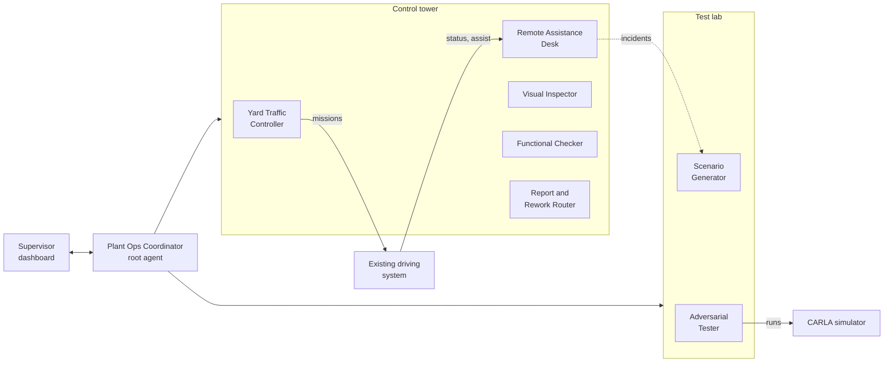
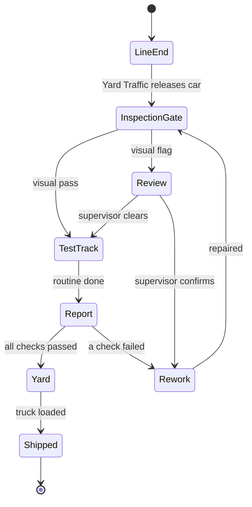
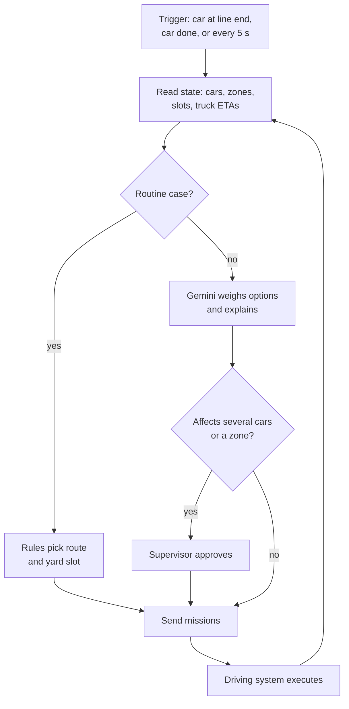
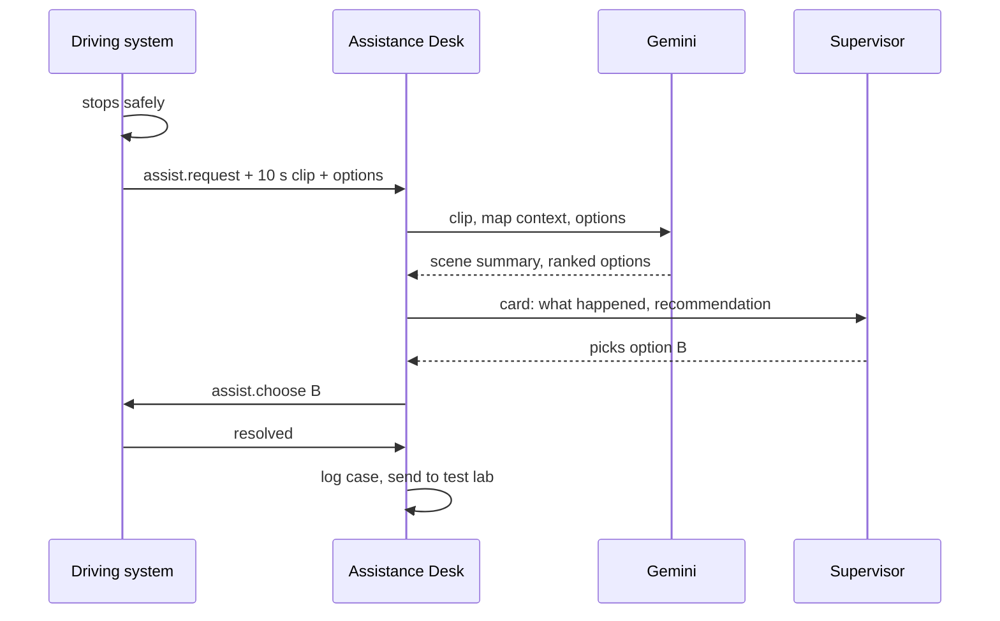
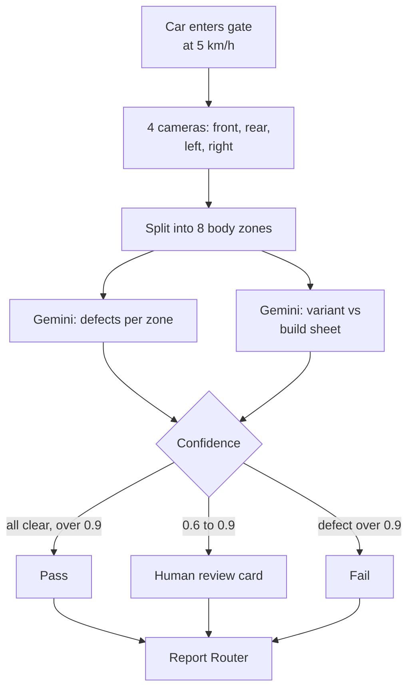
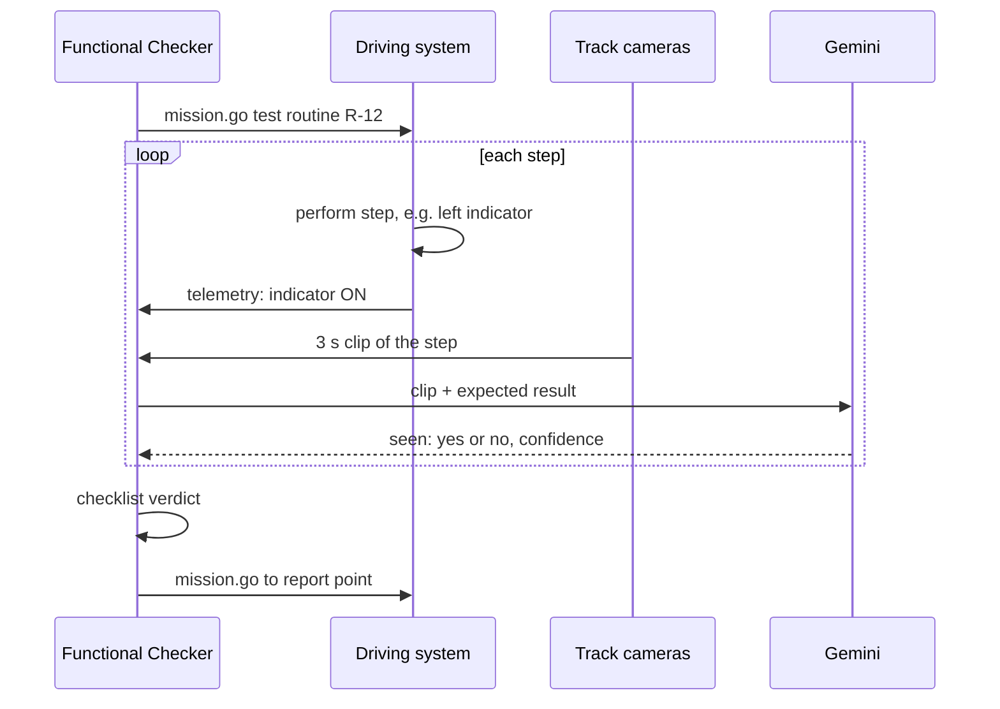
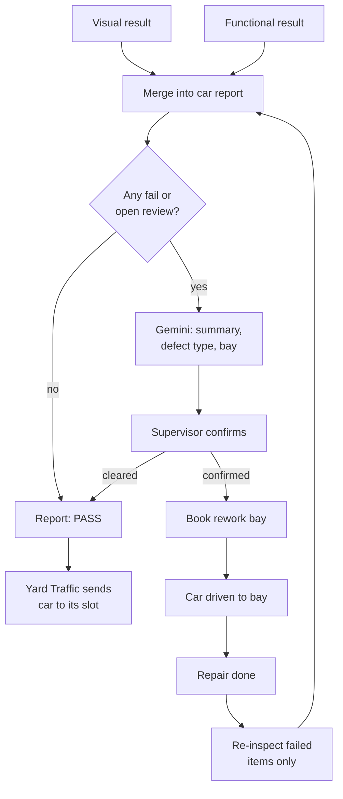
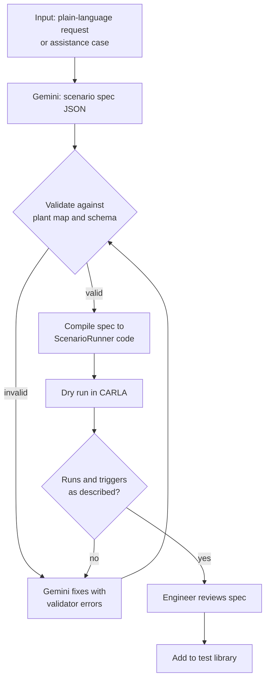
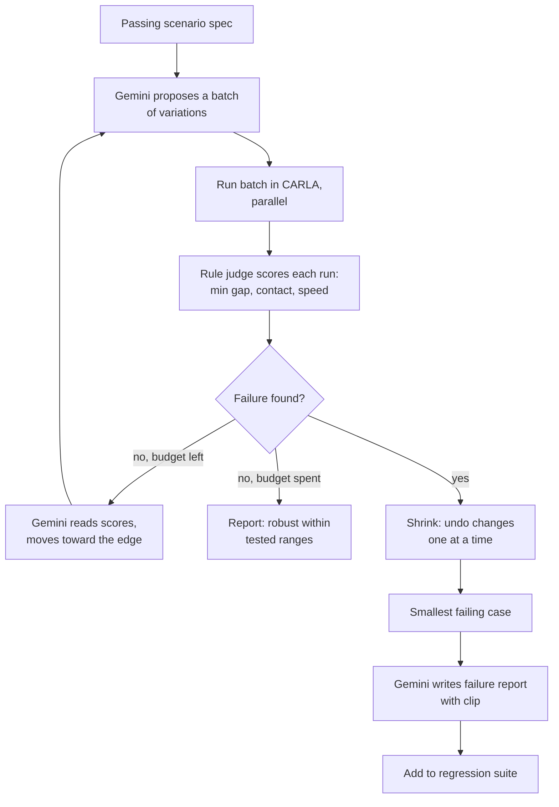
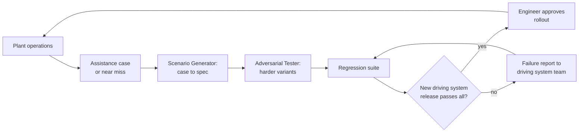

# Marshal flow design

Sep 25, 2026 · @Rey

## Overview

Marshal never drives a car. An existing, validated self-driving system drives; Marshal's Gemini agents run the operation around it and test it before every release.

**Two modes, one system:**

- **Control tower (operations).** Decides which car goes where and when, helps the driving system when it gets stuck, inspects every car visually and functionally, and routes defects to rework.
- **Test lab (before release).** Turns plain-language situations and real incidents into simulation tests, then searches for variations that make the driving system fail.

The two modes feed each other: every stuck car or near miss in operations becomes a new test in the lab.

### What the agents can and cannot do

| The agents can | The agents cannot |
| --- | --- |
| Send missions: go to a slot, hold, resume, pull over | Steer, brake or accelerate a car |
| Choose between options the driving system offers | Override the driving system's own safety stops |
| Pass or flag a car, propose rework | Release a car to shipping without a passed report |
| Generate and run simulation tests | Change the driving system's software |

### The driving system interface

Marshal talks to the driving system only through a mission API. In the hackathon, CARLA's built-in BehaviorAgent plays the role of the existing driving system.

| Direction | Message | Example |
| --- | --- | --- |
| Marshal → driving system | `mission.go` | VIN-214 to inspection gate, then test track, then slot Y7 |
| Marshal → driving system | `mission.hold` / `mission.resume` | Hold VIN-214 at line end for 40 s |
| Marshal → driving system | `assist.choose` | Take option B: wait for forklift |
| Driving system → Marshal | `status` | Position, speed, route progress, 1 Hz |
| Driving system → Marshal | `assist.request` | Stuck: unknown object in lane, 3 options |
| Driving system → Marshal | `mission.done` | Arrived at slot Y7 |

## System map

Seven capabilities run as six Gemini agents under one coordinator; five serve the control tower and two serve the test lab.



The driving system and CARLA are the only things that move cars; every agent reaches them through missions or test runs.

| # | Capability | Agent | Main inputs | Main outputs | Gemini does |
| --- | --- | --- | --- | --- | --- |
| 1 | Yard traffic controller | Yard Traffic Controller | Line schedule, car status, yard slots, truck ETAs | Missions: release, route, hold | Trade-offs and exceptions; routine dispatch is rules |
| 2 | Remote assistance desk | Remote Assistance Desk | `assist.request` + camera clip | Recommended option for a human | Reads the scene, ranks options, explains |
| 3 | Drive-through visual inspection | Visual Inspector | Gate camera images, build sheet | Pass, review or fail per zone | Finds defects, checks variant against build sheet |
| 4 | Functional check on test track | Functional Checker | Test routine, track cameras, vehicle telemetry | Checklist verdict per item | Confirms lights, indicators and actions on video |
| 5 | Inspection report and rework routing | Report and Rework Router | Results from 3 and 4 | Car report, rework ticket, next mission | Writes the report, picks the rework bay |
| 6 | Scenario generator | Scenario Generator | Plain-language request or incident | Validated CARLA scenario | Turns text into a structured scenario and code |
| 7 | Adversarial test agent | Adversarial Tester | A passing scenario + its parameters | Smallest failing variant + report | Chooses what to vary, explains failures |

### Real-world evidence at a glance

Every flow copies a method a manufacturer, an autonomous-driving operator or a peer-reviewed paper already uses; Marshal's change is running each one on Gemini and connecting them in one system.

| Flow | Who does it today | Method Marshal reuses | Where Gemini comes in |
| --- | --- | --- | --- |
| 1 Yard traffic | [BMW with Embotech](https://embotech.ai/automated-vehicle-marshalling-solution), [Ford E-SELF](https://www.assemblymag.com/articles/97746-ford-cars-could-soon-drive-themselves-off-the-assembly-line) | Fleet manager assigns missions; the vehicle interface executes | Reasoning about exceptions such as late trucks |
| 2 Remote assistance | [Waymo fleet response](https://waymo.com/blog/2024/05/fleet-response/) | Vehicle asks a question; a human answers; the vehicle stays in control | Reads the clip and ranks the options before the human decides |
| 3 Visual inspection | [BMW AIQX](https://www.bmwgroup.com/en/news/general/2023/aiqx.html), [UVeye](https://uveye.com/oems/) | Cameras on the line or a drive-through gate; AI finds defects and wrong variants | Multimodal defect finding and build-sheet comparison |
| 4 Functional check | [End-of-line test systems](https://foriauto.com/2020/01/21/automotive-end-of-line-wheel-alignment-headlamp-aiming-roll-and-brake-testing), [BMW test course](https://www.bmwgroup.com/en/news/general/2024/afw.html) | Scripted checks on every finished car | Confirms each step on video against telemetry |
| 5 Report and rework | [BMW AIQX](https://www.bmwgroup.com/en/news/general/2023/aiqx.html), [Google Cloud Gemini inspection pattern](https://cloud.google.com/blog/topics/developers-practitioners/gemini-live-api-real-time-ai-for-manufacturing) | Results pushed to workers; structured defect records logged | Writes the report and chooses the rework bay |
| 6 Scenario generator | [ChatScene, CVPR 2024](https://arxiv.org/abs/2405.14062) | LLM turns text into a scenario language, then simulator code | Gemini writes the spec; a fixed compiler writes the code |
| 7 Adversarial tester | [DriveFuzz, CCS 2022](https://arxiv.org/abs/2211.01829), [Scenic/VerifAI](https://arxiv.org/abs/2107.04164) | Mutate scenarios, rule-based oracles, search for failures | Chooses what to vary next and explains failures |

## A car's journey

Every finished car passes the same five checkpoints; an agent owns each decision point, and the driving system does all the driving in between.



At any point the driving system can raise `assist.request`; the car pauses in place until the Remote Assistance Desk and a human resolve it.

| Checkpoint | Who decides | Decision | Time budget |
| --- | --- | --- | --- |
| Line end | Yard Traffic Controller | Release now or hold | Under 1 s |
| Inspection gate | Visual Inspector | Pass, review or fail | Under 5 s while the car rolls through |
| Test track | Functional Checker | Verdict per checklist item | 60 to 90 s routine |
| Report | Report and Rework Router | Yard or rework, which bay | Under 10 s |
| Anywhere | Remote Assistance Desk + human | Which option the car takes | Under 30 s to a human decision |

## Flow 1: Yard traffic controller

Rules handle routine release and routing every second; Gemini is called only when a trade-off or exception needs judgement.

&#91;image: Yard traffic controller: cars leave the line end through the inspection gate and test track to yard slots grouped by truck; routine releases follow rules while a delayed truck triggers a Gemini re-slotting proposal that needs approval\]



**Routine rules (no AI call):**

- Release a car only when the inspection gate queue has fewer than 2 cars and the first route segment is clear.
- Assign yard slots by truck: cars for the next truck go to slots nearest the loading bay.
- Keep at least 25 m between released cars.

**Exceptions that go to Gemini:**

| Situation | Example decision |
| --- | --- |
| Truck delayed 40 min | Re-slot 6 cars so the next truck's cars are loadable first |
| Test track closed for maintenance | Hold 3 cars at line end, or park them untested in buffer zone B with a flag |
| Rework bay full | Send the flagged car to the yard with a do-not-ship hold |
| Line running faster than the yard | Recommend slowing releases and say by how much |

**Outputs:** `mission.go`, `mission.hold`, `mission.resume`; a reason is logged with every exception decision. **KPIs:** cars per hour, line-to-yard time, cars waiting at line end, truck loading delay.

### Real-world basis

**The case.** BMW moves finished cars without drivers in its plants using Embotech's Automated Vehicle Marshalling. According to [Embotech](https://embotech.ai/automated-vehicle-marshalling-solution), its fleet management system assigns missions, coordinates multiple vehicles, plans routes and tracks every car. The company reports more than 3,500 vehicles a day across seven sites (Dingolfing, Regensburg, Leipzig, Debrecen, Oxford, Spartanburg, plus a proof of concept in Switzerland), roughly 50% lower direct driver costs, and TÜV SÜD safety certification in 2024 (vendor figures). [Ford's E-SELF trial in Cologne](https://www.assemblymag.com/articles/97746-ford-cars-could-soon-drive-themselves-off-the-assembly-line) uses the same split: plant infrastructure controls and monitors the cars, because final testing needs a dozen or more trips between locations.

**The method Marshal keeps.** A fleet manager decides missions (where each car goes and when), and a separate, certified driving layer executes them. This is exactly Marshal's mission API boundary.

**What Gemini adds.** Today's fleet managers optimise routine flow well. Marshal adds a Gemini layer for the judgement calls around it: a truck arriving 40 minutes late, a closed test track, a full rework bay. Gemini proposes a re-plan with its reasoning, a human approves anything that affects several cars, and the rules engine keeps running routine dispatch.

## Flow 2: Remote assistance desk

When the driving system is unsure, it stops safely and asks; the agent prepares the answer, and a human always makes the final choice.

&#91;image: Remote assistance: the driving system stops before a box with a worker nearby and asks for help; the assistance card ranks three options with wait recommended; the supervisor picks it and the case goes to the test lab\]



The card reaches the supervisor in about 5 s; the car stays stopped until a human answers.

**What the assistance card shows:**

1. One-line situation: "Cardboard box in lane near finishing, car VIN-231 stopped 4 m before it."
2. The clip with the object boxed.
3. The driving system's own options, ranked with a reason, e.g. **A** wait for removal, **B** pass using the empty left lane at 3 km/h, **C** reroute via lane C (+2 min).
4. Recommended option and confidence; high-risk options (near people) are never recommended.

**Rules:**

- The agent can only choose among options the driving system offers; it cannot invent a path.
- No answer within 60 s: the car stays stopped and the case escalates to the shift lead.
- People or moving equipment in the scene: "wait" is the only recommendation.

**Outputs:** `assist.choose`, a case record, and the case sent to the Scenario Generator (flow 6). **KPIs:** cases per shift, time to resolution, repeat cases per location.

### Real-world basis

**The case.** Waymo runs a [fleet response](https://waymo.com/blog/2024/05/fleet-response/) team. When a robotaxi meets something ambiguous, such as an unusual cone layout, an emergency vehicle or a blocked street, it asks a question. A remote agent looks at the camera feeds and answers, for example by confirming a lane closure or suggesting a path. Waymo states that its driving system "is in control of the vehicle at all times" and evaluates the agent's input rather than simply following it.

**The method Marshal keeps.** Question-and-answer assistance, not remote driving. The vehicle stops safely, offers options, a person chooses, and the driving system executes. Marshal's `assist.request` and `assist.choose` messages copy this pattern for plant vehicles.

**What Gemini adds.** In Waymo's model, a human reads the scene from scratch for every question. In Marshal, Gemini reads the 10-second clip first and writes a one-line situation summary. It ranks the driving system's own options and flags risk, e.g. "a person is 3 m away, so only 'wait' is recommended." The human still decides, but faster. Google's own driving research supports using Gemini to understand driving scenes: [Waymo's EMMA](https://waymo.com/blog/2024/10/introducing-emma/) is built on Gemini and works mainly from camera images.

## Flow 3: Drive-through visual inspection

Four gate cameras photograph each car at walking speed; Gemini checks every body zone and compares the car with its build sheet, then confidence decides whether a human looks.

&#91;image: Visual inspection: a four-camera gate photographs the car, Gemini checks eight body zones and flags a scratch on the rear left door for review, and the build sheet check finds a missing rear badge\]



Images go to Cloud Storage and each zone result to BigQuery, so every verdict can be traced back to a photo.

| Check | Example finding | Source |
| --- | --- | --- |
| Paint and body | Scratch 6 cm, rear left door | Zone images |
| Panel fit | Gap at bonnet wider on the right side | Front image, left/right comparison |
| Missing parts | Rear badge missing | Rear image vs build sheet |
| Wrong variant | Build sheet says roof rails; none fitted | Side images vs build sheet |
| Wrong colour or trim | Build sheet says blue, car is red | All images vs build sheet |

**Structured output per car:**

```json
{
  "vin": "VIN-231",
  "verdict": "REVIEW",
  "findings": [
    {"zone": "rear_left_door", "type": "scratch", "size_cm": 6,
     "confidence": 0.78, "image": "gs://marshal/gate/VIN-231/left_03.jpg"}
  ],
  "build_sheet_mismatches": []
}
```

**KPIs:** first-pass yield, share of cars sent to human review, confirmed defects vs false alarms.

### Real-world basis

**The cases.**

- **BMW AIQX.** [BMW's AIQX platform](https://www.bmwgroup.com/en/news/general/2023/aiqx.html) uses cameras and sensors on the production line with AI that determines variants, checks completeness and detects anomalies in real time, across BMW plants worldwide.
- **UVeye.** [UVeye](https://uveye.com/oems/) sells drive-through inspection for carmakers, used from the assembly line to ports and dealers. It detects surface damage, paint issues, missing fasteners, and missing or wrong wheels, tyres and emblems. It lists Ford, GM, Toyota, Hyundai, Volvo Cars and JLR as OEM partners and reports finding more than 10% more defects than human inspection (vendor figures).
- **Google Cloud.** Google's earlier [Visual Inspection AI](https://www.prnewswire.com/news-releases/google-clouds-visual-inspection-ai-reinvents-manufacturing-quality-control-301317486.html) named Renault as an adopter for factory quality control. Google Cloud's [Gemini Live API manufacturing example](https://cloud.google.com/blog/topics/developers-practitioners/gemini-live-api-real-time-ai-for-manufacturing) shows Gemini reading a product code, finding and measuring defects on a camera stream and returning a JSON report per defect.

**The method Marshal keeps.** A camera gate that every car passes; AI checks both defects and the correct variant for that car; structured results per zone.

**What Gemini adds.** A dedicated vision model has to be trained for each defect type. Gemini can also compare what it sees against the car's build sheet in plain language ("roof rails expected, none fitted") and explain each finding, following the same pattern as Google's Gemini inspection example. Confidence thresholds send uncertain cases to a person, as in the flow above.

## Flow 4: Functional check on the test track

The car runs a scripted routine on the track while cameras and the car's own telemetry are checked against a checklist; each item passes only when both sources agree.

&#91;image: Functional check: the car runs a six-step routine on the test track while cameras watch; the checklist compares telemetry with what Gemini sees and fails the brake lights because the left one is out\]



Telemetry says what the car thinks it did; the camera says what actually happened, which catches a blown bulb the car's electronics report as working.

| Step | Command sent to the car | Telemetry check | Camera check |
| --- | --- | --- | --- |
| 1 | Headlights on | Light state ON | Both headlights lit |
| 2 | Left, then right indicator | Indicator state | Correct side blinking |
| 3 | Brake lights | Brake pedal signal | All brake lights lit, including the third |
| 4 | Reverse 3 m | Gear R, speed | Reverse light on, car moves back straight |
| 5 | Brake test from 20 km/h | Deceleration curve | Stopping distance within limit |
| 6 | Full-lock turn left and right | Steering angle | Car tracks the expected circle |

In CARLA, lights are controllable and visible on camera, so steps 1 to 4 can be demonstrated, including a faulty car whose telemetry and camera disagree. Horn and wipers are not simulated and stay out of the hackathon scope.

**Outputs:** a checklist with pass or fail per step and the clip for each fail. **KPIs:** routine time per car, failures per item, disagreements between telemetry and camera.

### Real-world basis

**The cases.**

- **End-of-line testing is standard in car plants.** An [end-of-line system by Fori Automation](https://foriauto.com/2020/01/21/automotive-end-of-line-wheel-alignment-headlamp-aiming-roll-and-brake-testing), built for a car manufacturer, runs wheel alignment, camera-based headlamp aiming, and roll and brake tests (acceleration, cruise control, reverse gear, dynamic braking) at 30 cars per hour.
- **BMW runs the test course driverless.** At Dingolfing, [new cars drive themselves](https://www.bmwgroup.com/en/news/general/2024/afw.html) from assembly through a short test course to finishing.
- **BMW checks function with AI.** [AIQX's Acoustic Analytics](https://www.bmwgroup.com/en/news/general/2023/aiqx.html) analyses driving noises recorded from the seats at Dingolfing.

**The method Marshal keeps.** A fixed routine every car performs, with a pass or fail per item and results kept per VIN.

**What Gemini adds.** Fixed test rigs measure what they were built to measure. Marshal compares two independent sources for each step: what the car reports (telemetry) and what a camera actually sees, which Gemini judges from a short clip against the expected result. That catches faults such as a dead brake lamp the car's electronics report as working, and new checks can be added by editing a checklist instead of rebuilding a rig.

## Flow 5: Inspection report and rework routing

The router merges the visual and functional results into one report per car, then either releases the car to the yard or books the right rework bay after a human confirms.

&#91;image: Report and rework: the car report lists a paint scratch and a failed brake light, the car goes first to the electrical bay and then to paint, and only the failed items are re-inspected before the report turns to PASS\]



A car can reach shipping only with a report marked PASS; re-inspection repeats just the items that failed.

| Defect type | Rework bay | Typical time |
| --- | --- | --- |
| Paint scratch, small dent | Paint touch-up bay | 20 min |
| Panel gap, trim, missing badge | Body fit bay | 30 min |
| Lights, indicators, electrical | Electrical bay | 25 min |
| Brakes, steering | Mechanical bay | 45 min |
| Wrong variant | Hold for production control | Decided by a person |

**The report** is one page per car: verdict, each finding with its photo or clip, the rework performed and the re-inspection result. It is stored in BigQuery and shown on the dashboard, so quality staff can search by VIN, defect type or shift.

**KPIs:** rework rate by defect type, rework turnaround, cars shipped with an open finding (target: 0).

### Real-world basis

**The cases.**

- **BMW closes the quality loop on the line.** [AIQX](https://www.bmwgroup.com/en/news/general/2023/aiqx.html) sends its findings to production staff on smart devices, so a problem found by a camera reaches the person who fixes it right away. BMW describes the aim as transforming the end-to-end quality cycle.
- **Google Cloud reference pattern.** The [Gemini Live API manufacturing example](https://cloud.google.com/blog/topics/developers-practitioners/gemini-live-api-real-time-ai-for-manufacturing) has Gemini write a JSON record for every defect, a second Gemini service send alerts for severe issues, and every result logged to BigQuery.

**The method Marshal keeps.** Every finding becomes a structured record tied to a VIN and a photo, is pushed to the people who act on it, and is stored for traceability.

**What Gemini adds.** Marshal merges visual and functional results into one readable report per car. Gemini writes the summary, orders the repairs (safety items first) and proposes the rework bay. A supervisor confirms before the car moves, and re-inspection covers only the failed items. The storage and alerting follow Google's published Cloud Run + BigQuery pattern.

## Flow 6: Scenario generator

Gemini first writes a structured scenario spec, not code; the spec is validated against the plant map and then compiled into a CARLA test by a fixed template, which keeps generated tests runnable and reviewable.

&#91;image: Scenario generator: a plain-language request becomes a JSON spec, passes the validator, is compiled and run in CARLA at dusk, and is added to the test library\]



The fix loop is capped at 3 attempts; after that the request goes to an engineer with the validator's errors.

**Example.** Input: "A worker steps out from behind a parked forklift at dusk while a car turns into the finishing lane."

```json
{
  "id": "SC-0142",
  "source": "supervisor request",
  "map_zone": "finishing_corner",
  "time_of_day": "dusk",
  "weather": "clear",
  "ego": {"route": "line_end->finishing", "speed_kmh": 8},
  "actors": [
    {"type": "forklift", "state": "parked", "position": "finishing_corner.p3"},
    {"type": "worker", "start": "behind:forklift", "walk_speed_ms": 1.3,
     "trigger": {"ego_distance_m": 9}}
  ],
  "pass_criteria": [
    "no_contact",
    "min_gap_to_person_m >= 1.5",
    "speed_near_person_kmh <= 5"
  ]
}
```

**Why a spec first:** named map points instead of raw coordinates, a closed list of actor types, and explicit pass criteria. Engineers review a short JSON file rather than generated Python, and the Adversarial Tester can vary any field directly.

### Real-world basis

**The paper.** [ChatScene](https://arxiv.org/abs/2405.14062) (Zhang et al., CVPR 2024) uses a large language model to turn plain-language descriptions into safety-critical driving scenarios. It splits a description into parts (vehicle behaviours, positions), translates them into a scenario language using a retrieval database of description-and-code pairs, and generates executable scenarios in CARLA. The generated scenarios raised collision rates by 15% over prior methods when tested against learned driving agents. Retraining those agents on them cut collision rates by 9%. The [code is public](https://github.com/javyduck/ChatScene).

**The method Marshal keeps.** Text first becomes an intermediate scenario description, and only then simulator code, which is what makes generated tests reliable enough to run. A retrieval library of validated examples guides generation.

**What Gemini adds.** Marshal uses Gemini as the language model, with one change for a plant setting: Gemini writes a short JSON spec checked against the plant's named map points, and a fixed compiler (not the model) writes the ScenarioRunner code. Scenarios can come from real remote-assistance cases (flow 2) as well as typed requests, so the plant's own incidents drive the test library.

## Flow 7: Adversarial test agent

Starting from a scenario the driving system passes, the agent varies its parameters to find a failure, then shrinks that failure to the smallest change from the passing case; code judges pass or fail, and Gemini chooses what to try and explains the result.

&#91;image: Adversarial tester: a grid of variants by light and trigger distance shows the minimum gap to the worker; the search moves from the passing case to a failure at night behind a pallet stack with a 0.6 m gap, which is shrunk and reported\]



The rule judge, not Gemini, decides pass or fail, so verdicts are repeatable; Gemini only decides where to search next and explains what went wrong.

| Parameter | Range searched | Example step |
| --- | --- | --- |
| Worker trigger distance | 4 to 15 m | 9 m → 7 m |
| Worker speed | 0.8 to 2.5 m/s | walk → jog |
| Light | noon, dusk, night | dusk → night |
| Weather | clear, rain, fog | clear → light rain |
| Occluder | none, forklift, parked car, pallet stack | forklift → pallet stack |
| Ego speed | 5 to 10 km/h | 8 → 10 km/h |
| Second actor | none, car ahead braking | add car ahead |

**Example failure report:** "SC-0142-v17 fails: at night, with the worker triggering at 7 m and jogging at 2.1 m/s from behind a pallet stack, the car stopped 0.6 m from the worker (limit 1.5 m). The same case passes at dusk. Likely cause: late detection in low light behind a tall occluder. Suggest reducing speed near finishing\_corner at night to 5 km/h."

**Budget:** 60 runs per scenario for the hackathon, at 8 in parallel on one GPU VM. **KPIs:** failures found per 100 runs, time to first failure, regression suite size.

### Real-world basis

**The papers.**

- **DriveFuzz.** [DriveFuzz](https://arxiv.org/abs/2211.01829) (Kim et al., ACM CCS 2022) automatically generates and mutates driving scenarios in a simulator. It judges runs with test oracles based on real traffic rules and is guided by driving-quality metrics. It found 30 previously unknown bugs in two driving systems, Autoware and the CARLA Behavior Agent, plus 3 bugs in CARLA itself.
- **Scenic and VerifAI.** [Scenic and VerifAI](https://arxiv.org/abs/2107.04164) (UC Berkeley, RV 2021) do simulation-based falsification: sample scenario parameters, run in parallel, and search for counterexamples, with "rulebooks" that rank several safety metrics.

**The method Marshal keeps.** Rule-based oracles decide pass or fail; the search mutates scenario parameters toward failure; many runs go in parallel; failures become regression tests. Marshal's hackathon target, CARLA's BehaviorAgent, is the same system DriveFuzz found bugs in, so failures should be findable within a week.

**What Gemini adds.** Classic fuzzers mutate blindly or follow a numeric score. Marshal lets Gemini read the scores and clips of each batch and choose the next variations with a reason ("gap shrinks at night; try tall occluders next"). It then writes a plain-language failure report with a suggested fix. The rule judge, not Gemini, still decides every verdict, so results stay repeatable.

## The loop between operations and the test lab

Real cases from the plant become tests, tests find weaknesses before the next software release, and each release is only approved when the whole regression suite passes.



Marshal produces the evidence; engineers, not agents, approve a release.

**What this gives the plant:**

- A stuck car on Tuesday is a tested, fixed case by the next release.
- Each release comes with a report: tests run, passed, failed, and what changed since the last release.
- The same failure cannot quietly return, because its test stays in the suite.

## Shared data, events and human authority

All agents share six records and seven event topics; humans keep every decision that ships a car, sends it to rework, moves it near people or releases new driving software.

### Records

| Record | Key fields | Live copy | History |
| --- | --- | --- | --- |
| Car | VIN, build sheet, state, location, mission | Firestore | BigQuery |
| Assistance case | case id, VIN, clip, options, choice, resolved by | Firestore | BigQuery |
| Inspection result | VIN, zone findings, checklist, verdict | Firestore | BigQuery + Cloud Storage images |
| Car report | VIN, verdict, findings, rework, re-inspection | Firestore | BigQuery |
| Scenario | spec JSON, source, status, owner | — | BigQuery + Cloud Storage |
| Test run | scenario, variant, metrics, pass/fail, clip | — | BigQuery + Cloud Storage |

### Pub/Sub topics

| Topic | Publisher | Subscribers |
| --- | --- | --- |
| `vehicle-status` | Driving system | Yard Traffic, dashboard |
| `assist-requests` | Driving system | Remote Assistance Desk |
| `gate-images` | Gate cameras | Visual Inspector |
| `track-steps` | Driving system + track cameras | Functional Checker |
| `inspection-results` | Visual Inspector, Functional Checker | Report and Rework Router |
| `test-requests` | Assistance Desk, supervisor, engineers | Scenario Generator |
| `test-results` | CARLA runners | Adversarial Tester, dashboard |

### Human authority

| Decision | Agent | Human |
| --- | --- | --- |
| Release a car from line end, routine route | Decides | Sees on dashboard |
| Re-slot several cars, hold a zone | Proposes | Approves |
| Choose an option when a car is stuck | Recommends | Always decides |
| Pass a car at inspection (confidence over 0.9) | Decides | Can audit |
| Send a car to rework | Proposes | Confirms |
| Add a scenario to the test library | Generates | Engineer reviews |
| Approve a driving system release | Provides evidence | Engineer decides |

## Hackathon scope and demo script

Build all seven flows at demo depth in one week, with CARLA's BehaviorAgent standing in for the existing driving system; the test lab is the centrepiece because it is the most novel part.

### What is real and what is stand-in

| Part | In the hackathon | Stand-in, stated openly |
| --- | --- | --- |
| Driving system | CARLA BehaviorAgent via a small mission API | A real plant AV system |
| Yard traffic, assistance, report routing | Fully built agents | — |
| Visual inspection | Gemini on gate images; variant check on CARLA car colour and model | Scratches and dents use a public car-damage image set |
| Functional check | Lights, indicators, brake lights, reverse, brake test in CARLA | Horn and wipers left out |
| Scenario generator, adversarial tester | Fully built, running real CARLA tests | — |

### Five-minute demo script

1. **Normal flow, 45 s.** Cars leave the line; Yard Traffic releases them; one passes the gate and the track routine with a clean report.
2. **Inspection catches two faults, 60 s.** A car arrives in the wrong colour for its build sheet and is flagged. Another has a dead left brake light: telemetry says ON, the camera shows it off. Both are confirmed and booked into rework bays.
3. **Stuck car, 45 s.** A box in the lane; the driving system stops and asks. The assistance card recommends "wait" because a worker is nearby; the supervisor picks it; the case is sent to the test lab.
4. **Test lab, 90 s.** The supervisor types a situation in plain language. Gemini produces the spec, it compiles and runs; the driving system passes. The Adversarial Tester runs variations live and finds a failure at night behind a pallet stack, then shows the report and clip.
5. **Close, 30 s.** The failure joins the regression suite; the release gate shows "1 failing test, release blocked". "The AI never drives. It runs the yard, checks every car and tries to break the driving software before it reaches the plant."

### One-week plan

| Day | Plant and CARLA | Agents | Test lab | UI |
| --- | --- | --- | --- | --- |
| 1 | CARLA on GPU VM, mission API over BehaviorAgent | ADK skeleton, Pub/Sub topics, records | Spec schema and plant map points | Dashboard layout |
| 2 | Gate cameras, track routine with lights | Yard Traffic rules + exceptions | Spec to ScenarioRunner compiler | Live yard map |
| 3 | Assistance requests from BehaviorAgent | Visual Inspector, Functional Checker | Scenario Generator with fix loop | Inspection and checklist views |
| 4 | Faulty-car and wrong-variant cases | Report and Rework Router | Rule judge and parallel runner | Rework and report pages |
| 5 | Scripted demo scenes | Remote Assistance Desk | Adversarial search and shrinking | Assistance card, test lab page |
| 6 | Tuning, recorded backup runs | End-to-end testing | Regression suite and release gate | Polish |
| 7 | Final recordings | Fixes | Fixes | Pitch deck, two rehearsals |

**Checkpoint:** by the end of day 3, one generated scenario must run in CARLA and be judged pass or fail automatically.

## Sources

Vendor figures (Embotech, UVeye, Google Cloud) are the companies' own claims; quote them as such in the pitch.

**Manufacturers and operators**

1. [Embotech, Automated Vehicle Marshalling](https://embotech.ai/automated-vehicle-marshalling-solution)
2. [BMW Group, Automated driving in BMW plants](https://www.bmwgroup.com/en/news/general/2024/afw.html)
3. [Assembly Magazine, Ford cars could soon drive themselves off the assembly line](https://www.assemblymag.com/articles/97746-ford-cars-could-soon-drive-themselves-off-the-assembly-line)
4. [Waymo, Fleet response: lending a helpful hand to Waymo's autonomously driven vehicles](https://waymo.com/blog/2024/05/fleet-response/)
5. [Waymo, Introducing EMMA](https://waymo.com/blog/2024/10/introducing-emma/)
6. [BMW Group, How AI is revolutionising production (AIQX)](https://www.bmwgroup.com/en/news/general/2023/aiqx.html)
7. [UVeye for OEMs](https://uveye.com/oems/)
8. [Fori Automation, Automotive end of line: wheel alignment, headlamp aiming, roll and brake testing](https://foriauto.com/2020/01/21/automotive-end-of-line-wheel-alignment-headlamp-aiming-roll-and-brake-testing)
9. [Google Cloud, Visual Inspection AI announcement](https://www.prnewswire.com/news-releases/google-clouds-visual-inspection-ai-reinvents-manufacturing-quality-control-301317486.html)
10. [Google Cloud Blog, Gemini Live API: real-time AI for manufacturing](https://cloud.google.com/blog/topics/developers-practitioners/gemini-live-api-real-time-ai-for-manufacturing)

**Research papers**

11. [Zhang et al., ChatScene: Knowledge-Enabled Safety-Critical Scenario Generation for Autonomous Vehicles, CVPR 2024](https://arxiv.org/abs/2405.14062)
12. [Kim et al., DriveFuzz: Discovering Autonomous Driving Bugs through Driving Quality-Guided Fuzzing, ACM CCS 2022](https://arxiv.org/abs/2211.01829)
13. [Viswanadha et al., Parallel and Multi-Objective Falsification with Scenic and VerifAI, RV 2021](https://arxiv.org/abs/2107.04164)
14. [Curiel-Ramirez et al., Optimizing industrial transport with a connected automated vehicle demonstrator, Scientific Reports 2024](https://www.nature.com/articles/s41598-024-58627-1)
